# Sarvam Microfinance — Complete System Workflow & Technical Reference
**Version:** 2.0  
**Status:** Current System Reference (Authoritative Executable Code Baseline)  
**Baseline Reference:** Version 1.0 (June 2026 — Historical Baseline)  
**Classification:** Internal Operational & Technical Documentation  

---

## 1. Document Information & Version History

### 1.1 Document Purpose
This document represents the definitive, authoritative system manual and technical reference for the **Sarvam Microfinance** platform. Unlike Version 1.0, which outlined idealized operational workflows and preliminary design assumptions, Version 2.0 has been compiled through an exhaustive, read-only empirical audit of the current executable codebase, database schema (`prisma/schema.prisma`), API controllers, service handlers, and background workers (Batches 1 through 11).

This manual establishes what the software **actually executes**, resolving historical contradictions, removing obsolete references, and formalizing the exact rules governing multi-branch operations, client underwriting, loan lifecycle management, accounting, collections, and reporting.

### 1.2 Version History & Audit Traceability

| Version | Date | Authors / Context | Key Changes & Distinctions from Previous Baseline |
| :--- | :--- | :--- | :--- |
| **1.0** | June 2026 | Initial Operational Draft | Documented preliminary 4-tier role model, manual voucher posting queues, hypothetical 06:00 PM operational lockouts, non-implemented NOC modules, and linear loan state chains. |
| **2.0** | September 2026 | System Audit Team | **Authoritative Rebuild:**<br>• Fully decoupled dynamic RBAC/ABAC engine with custom DB roles, `SUB_ADMIN`, and `DIVISION_MANAGER`.<br>• Disproved active 06:00 PM branch lockout (operations permitted 24/7).<br>• Corrected login authentication credential to `employeeId` + `password` (Web) and device-bound flow (Mobile).<br>• Formalized orthogonal loan state machines (`LoanApplicationStatus`, `DisbursementStatus`, `LoanStatus`).<br>• Documented automated operational GL posting via idempotency keys (`postingMarker`).<br>• Removed non-existent NOC certificate workflow (retaining KYC upload fields only).<br>• Formalized manual BM Gold Loan valuation (uncoupled from active `GoldPrice` catalog).<br>• Documented strict reversal hierarchy (`EOD Revert → Allocation Revert → Collection Revert → Disbursement Revert`).<br>• Detailed dual-engine reporting (synchronous streaming vs asynchronous Puppeteer queue) and Times New Roman 11pt export standard with `Math.trunc` presentation rules. |

---

## 2. System Overview & Technology Stack

### 2.1 System Ethos
Sarvam Microfinance is an enterprise-grade Core Banking and Loan Management System designed specifically for Joint Liability Group (JLG) microfinance operations, collateralized gold lending, and community financial services. The system organizes field operations around **Branches**, **Centers**, and **Groups**, enforcing strict Maker-Checker dual authorization, operational working-date integrity, and auditable financial double-entry bookkeeping.

### 2.2 Core Technical Stack

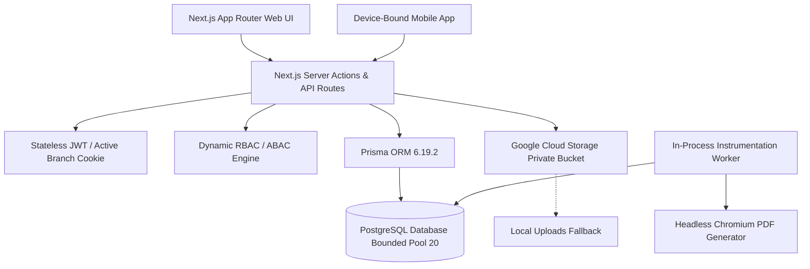

- **Runtime & Web Framework:** Next.js 16.0.7 (App Router architecture with standalone server output), React 19.2.0, TypeScript 5.
- **Data Persistence Layer:** PostgreSQL relational database managed via Prisma ORM 6.19.2. Connection pooling is strictly bounded to 20 client connections to prevent pool exhaustion on high concurrency.
- **Background Processing:** In-process event loop worker initiated via `instrumentation.ts`, executing database job polling via PostgreSQL `FOR UPDATE SKIP LOCKED` semantics.
- **Document & Media Storage:** Private Google Cloud Storage (GCS) bucket. Media access is gated strictly via short-lived signed URLs (15-minute expiration) generated by server utilities. A fallback to `public/uploads/` exists for isolated development environments.
- **Reporting & Export Engines:** Dual architecture:
  1. Synchronous streaming in-memory generator for tabular CSV/Excel and quick UI rendering.
  2. Asynchronous job queue (`ReportRequest`) executed by background workers utilizing headless Puppeteer (Chromium) for complex, high-volume PDF and ledger compilation.

---

## 3. Organizational Hierarchy

The platform models operational jurisdiction across two distinct organizational trees: the administrative geographic structure and the field operational structure.

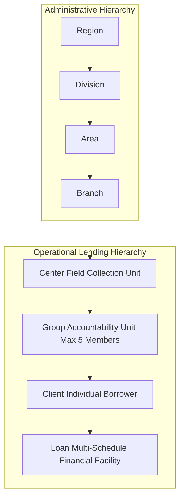

### 3.1 Geographic Administrative Tree
1. **Region:** The top-level geographic territory grouping multiple divisions.
2. **Division:** Administrative cluster supervised by Division Managers.
3. **Area:** Supervisory cluster grouping up to 4 contiguous branches, overseen by an Area Manager.
4. **Branch:** The primary accounting and operational entity. Every financial transaction, ledger, cash vault, working date, and employee roster is anchored to a specific Branch.

### 3.2 Operational Lending Tree
1. **Center:** The field operational unit. A Center represents a specific village, neighborhood, or meeting venue with a designated meeting day (e.g., Every Wednesday) and frequency (Weekly, Fortnightly, Monthly). Centers are assigned to frontline Field Development Officers (FDOs).
2. **Group:** A mutual accountability unit within a Center, following the Joint Liability Group (JLG) peer-guarantee model. Code enforces a strict capacity limit of **maximum 5 members per group** via `GroupAssignmentConfig`.
3. **Client:** The registered, KYC-verified individual borrower.
4. **Loan:** The sanctioned financial facility linked to an individual client, backed by mutual group guarantee or physical gold collateral.

---

## 4. Dynamic RBAC/ABAC Engine & User Roles

### 4.1 Hybrid Authorization Engine
The authorization engine (`app/lib/permissions/engine.ts`) implements a hybrid **Role-Based Access Control (RBAC)** and **Attribute-Based Access Control (ABAC)** mechanism rather than a hardcoded enum check:

1. **Dynamic Database Roles:** Roles are defined in the `Role` model, associating specific permission slugs (`RolePermission`) to users (`UserRole`).
2. **Explicit DENY Precedence:** If a user possesses multiple roles and any assigned role has `isGranted = false` for a specific permission slug, access is unconditionally denied.
3. **Role Priority Resolution:** In the event of conflicting metadata or tier checks, the role with the highest integer priority takes precedence.
4. **ABAC Scopes:** Permissions are constrained at runtime by contextual attributes:
   - **Branch Scoping:** Operations are strictly constrained to the user's assigned branch or active branch context.
   - **Disbursement Caps (`maxDisbursementAmount`):** Manager roles can be constrained by maximum financial sanction thresholds.
   - **Ownership Scoping:** Frontline officers can be restricted to clients and centers assigned directly to them.

### 4.2 Primary System Roles & Responsibilities

| Role Identifier | Role Tier | Supervised Jurisdictions | Core Operational Capabilities |
| :--- | :--- | :--- | :--- |
| **`ADMIN`** | Tier 1 (Head Office) | All Regions, Divisions, Branches | Full system control; master data setup; user administration; EOD Revert authorization; manual GL voucher final approval; system-wide MIS report extraction. |
| **`SUB_ADMIN`** | Tier 1.5 (Corporate) | All assigned Branches | Administrative delegation; master oversight; operational report audits; user activity monitoring. |
| **`DIVISION_MANAGER`** | Tier 2 (Regional) | Multiple Areas / Divisions | Macro portfolio performance monitoring; divisional target tracking; supervisory compliance reviews. |
| **`AREA_MANAGER` (AM)** | Tier 3 (Cluster) | Assigned Branches (up to 4) | Level 2 Loan Index approvals; Foreclosure Maker-Checker approvals (with self-approval prevention); Gold GIVE approval; manual financial voucher review. |
| **`BRANCH_MANAGER` (BM)** | Tier 4 (Branch Unit) | Single Home Branch | Level 1 Loan Index verification; BM Disburse final cash release; collection batch approvals; EOD execution; cash denomination reconciliation; manual voucher creation. |
| **`FIELD_DEVELOPMENT_OFFICER` (FDO)** | Tier 5 (Field Unit) | Assigned Centers | Frontline client enrollment; KYC document uploads; loan application origination; center meeting conduction; collection receipt submissions. |

---

## 5. Authentication, Branch Context & Session Management

### 5.1 Web Application Authentication
- **Login Credentials:** Web authentication (`app/api/auth/login/route.ts`) strictly requires **Employee ID (`employeeId`)** and **Password (`password`)**. Input is validated via Zod schema (`min(1)` for Employee ID, `min(6)` for password).
- **Credential Storage:** Passwords are encrypted using bcrypt hashing (10 salt rounds).
- **Session Tokens:** Upon successful verification, the system issues:
  - **Access Token:** Stateless JWT expiring in 72 hours, containing `userId`, `email`, `role`, `branchId`, and optional assigned branch arrays.
  - **Refresh Token:** Stateless JWT expiring in 7 days, allowing transparent token renewal via `/api/auth/refresh`.

### 5.2 Mobile Application Authentication
- **Device-Bound Pipeline:** Mobile authentication (`app/api/mobile/login/route.ts`) implements a two-step device-bound flow requiring `employeeId`, `password`, and a permanent hardware `deviceId`.
- **MPIN Handshake:**
  - If MPIN is unconfigured: Issues a temporary scoped `mpinSetupToken` prompting mandatory MPIN registration via `/api/mobile/mpin/setup`.
  - If MPIN is established: Issues an `mpinLoginToken` allowing re-authentication via 4-digit biometric MPIN without repeatedly entering master credentials.
  - Token expiration for bound mobile devices is issued without a fixed time expiry, remaining bound to the hardware signature until remote revocation.

### 5.3 Multi-Branch Context & Session Switching
- **Branch Scope Resolution:** Users assigned to multiple branches (e.g., Area Managers via `AreaManagerBranch` or floating officers via `UserBranchAssignment`) maintain an active operational context.
- **Active Branch Tracking:** The currently selected branch is persisted in an HttpOnly cookie named `sarvam_active_branch` and propagated across API requests via the `x-branch-id` HTTP request header.
- **Branch Isolation:** Data queries across clients, centers, loan indexes, and vouchers enforce mandatory `where: { branchId: activeBranchId }` predicates, preventing accidental cross-branch data bleed.

---

## 6. Complete End-to-End System Lifecycle

```mermaid
sequenceDiagram
    autonumber
    actor FDO as Field Officer (FDO)
    actor BM as Branch Manager (BM)
    actor AM as Area Manager (AM)
    actor Sys as System Services
    actor Safe as Cash / Safe Vault

    Note over FDO,Sys: Phase 1: Onboarding & Sanction
    FDO->>Sys: Enroll Client (Personal details, KYC, Group assignment)
    BM->>Sys: BM Review (Pass/Return/Reject)
    AM->>Sys: AM Review (Pass/Return/Reject)
    Sys->>Sys: Final Approval -> Trigger createFirstLoanIfEligible()
    Note right of Sys: Spawns Loan in PENDING state

    Note over FDO,Safe: Phase 2: Indexing & Disbursement
    FDO->>Sys: Complete MI & GRT Field Verifications
    BM->>Sys: Create Loan Index (Freezes indexedAmount, groups by center)
    BM->>Sys: Submit Index for Level 2 Review
    AM->>Sys: Approve Index at Level 2
    BM->>Sys: Execute BM Disburse (Pre-checks pass)
    Sys->>Safe: Release Cash to Borrowers
    Sys->>Sys: Auto-Generate LoanSchedules (Excluding non-working days)
    Sys->>Sys: Auto-Post GL FinancialTransaction ([POSTING:INDEX:...])

    Note over FDO,Sys: Phase 3: Collections & EOD
    FDO->>Sys: Record Center Demand Collections
    BM->>Sys: Approve Collection Batch
    BM->>Sys: Run EOD Allocation (Allocates collections, posts GL vouchers)
    BM->>Sys: Trigger EOD Close (Attendance verified, cash reconciled)
    Sys->>Sys: Advance BranchWorkingDate to next business date

    Note over BM,Sys: Phase 4: Closure / Preclosure
    BM->>Sys: Initiate Preclosure Request (Waives unearned future interest)
    AM->>Sys: Maker-Checker Preclosure Approval
    Sys->>Sys: Mark Loan CLOSED; Update Schedules
```

---

## 7. Client Enrollment & Dynamic Field Validation

### 7.1 Enrollment Architecture
Frontline officers initiate client onboarding via the Client Enrollment Workbench (`/clients/enroll`). The module captures comprehensive demographic, socio-economic, KYC, bank account, and co-applicant/nominee details.

### 7.2 Dynamic Validation Engine (`EnrollmentValidationConfig`)
The system does not rely on hardcoded field validation rules. Mandatory field presence and document capture requirements are governed dynamically by `EnrollmentValidationConfig`:
- **Document Rules:** Controls whether identity proofs (Aadhaar, Voter ID, PAN Card, Ration Card) and residential proofs are mandatory (`isRequired: true`) or optional.
- **NOC Image Capture:** Dedicated upload fields (`noc_image_1` through `noc_image_4`) allow capturing local No Objection Certificates (such as landlord or community clearances) directly into GCS during intake.
- **Biometric & Face Photos:** Client portrait photographs and Aadhaar front/back scans are verified before submission.

### 7.3 Group Assignment Constraint
Clients must be attached to an existing Center and Group. The enrollment engine verifies against `GroupAssignmentConfig` to ensure the selected group has **not exceeded the maximum threshold of 5 active members**.

---

## 8. KYC Verification & Approval Workbench

### 8.1 Workflow Configuration Engine (`ClientWorkflowConfig`)
Client approval progression is dynamically configurable per branch via `ClientWorkflowConfig`. The standard 4-stage pipeline can be customized or collapsed depending on branch tiering:

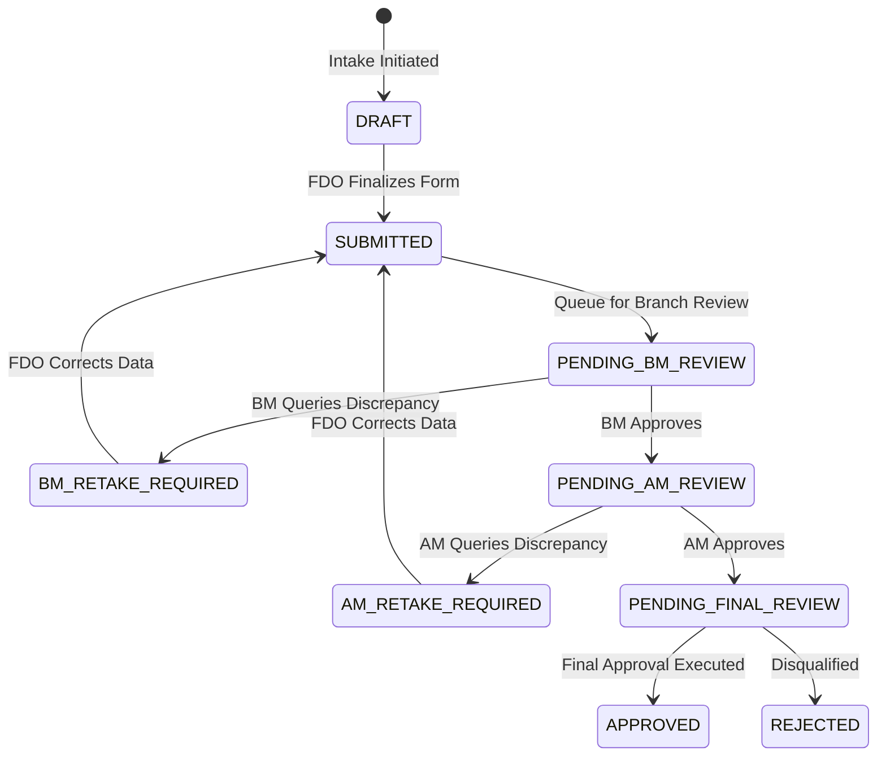

### 8.2 Quality Control (QC) Pre-Check Gate
Where branch policies mandate Quality Control verification, the Approval Workbench gates movement to final review on `qcStatus`:
- `PASSED`: Underwriting documentation verified; eligible for approval.
- `FAILED`: Document defects identified; returns application to `RETAKE_REQUIRED`.
- `PENDING`: Awaiting supervisor document scrutiny.

### 8.3 Document Re-Take Architecture
When a reviewer returns an application (`BM_RETAKE_REQUIRED`, `AM_RETAKE_REQUIRED`, or `FINAL_RETAKE_REQUIRED`), the record returns to the FDO's correction workbench with specific field-level audit rejection notes. Once corrected, resubmission routes the client back into the approval pipeline.

---

## 9. Automatic First-Loan Creation & Eligibility

### 9.1 The `createFirstLoanIfEligible` Execution Engine
When an application receives final approval (`APPROVED`) in the Approval Workbench (`app/api/approval/clients/[clientId]/action/route.ts`), the system automatically triggers `createFirstLoanIfEligible`.

### 9.2 Eligibility Preconditions
The service evaluates the following strict invariants before generating a first loan:
1. **Zero Prior Loans:** The client must possess exactly 0 existing records in the `Loan` table (`count == 0`).
2. **Complete Enrollment Loan Data:** The client's enrollment record must contain valid requested loan parameters (`loanAmount > 0`, valid `loanProductId`, and defined repayment frequency).
3. **Active Center & Group:** The client must belong to an active, non-suspended Center and Group.

### 9.3 Provisioning Outcome
Upon passing all invariants, the system atomically provisions:
- A new `Loan` record in status `PENDING` with `isActive = true`.
- An associated `LoanApplication` record in status `PENDING` (or `SUBMITTED`).
- Auto-generated system Loan Number following the format `LN` + Year + Sequence (e.g., `LN26001234`).
- Inherits the branch, center, group, product, and officer associations directly from the approved client profile.

---

## 10. Loan Product Master & Immutable Configuration

### 10.1 Product Parameters
Loan products are configured at the Head Office level via the Loan Product Master (`/masters/loan-products`). Each product defines financial constraints:
- **Principal Limits:** Minimum and maximum sanctioned amount boundaries.
- **Interest Rate & Method:** Annualized percentage rate and calculation methodology (**FLAT Rate** or **REDUCING Balance**).
- **Repayment Frequencies:** Daily, Weekly, Fortnightly, or Monthly.
- **Tenure:** Total number of installments (dues).
- **Upfront Deductions:** Insurance fee rates, document charges, and admission fees.
- **Advance Savings Rate:** Mandatory savings deposit collected alongside installments.

### 10.2 Downstream Immutability Invariant
Once a Loan Product is associated with an active, disbursed loan, its core financial terms (**Interest Rate, Calculation Method, Number of Dues, and Repayment Frequency**) are treated by the system as **immutable**. Downstream schedule generators and interest calculators consume the frozen parameters stamped onto the individual `Loan` record, ensuring that future master modifications never alter historical or active schedules.

### 10.3 Branch Product Mapping
Loan products must be explicitly activated for specific branches via `BranchProductMapping`. A Branch Manager cannot create or disburse loans against products not mapped to their operational branch.

---

## 11. Loan Application & Center/Group Association

### 11.1 Manual & Renewal Loan Origination
For clients completing existing loans (renewal loans) or ad-hoc loan requests, applications are initiated via `/loans/applications/create`.

### 11.2 Intake Parameters
- **Client Selection:** Restricted to clients in `APPROVED` status with no conflicting active overdue loans.
- **Product Selection:** Filtered strictly by active `BranchProductMapping`.
- **Sanction Amount:** Validated against product minimum/maximum bounds.
- **First Due Date Selection:** Proposed first installment collection date.

### 11.3 Relational Binding
The loan application establishes relational links:
- `branchId`: Inherited from the client's home branch.
- `centerId` & `groupId`: Bound to the client's current center and peer group.
- `userId`: Frontline officer originating the application.

---

## 12. Field Verification, MI & GRT

Before an application can progress to Loan Indexing, the system enforces strict frontline verification checks.

### 12.1 Member Individual (MI) Verification
- **Purpose:** Frontline physical verification of the client's residential dwelling, income stability, and family consent.
- **System Evidence:** Captures verification date, verifying officer ID, household income verification, and home visit confirmation.

### 12.2 Group Recognition Test (GRT)
- **Purpose:** Compulsory group training verification evaluating whether the 5 members of the JLG understand mutual joint liability, repayment schedules, and meeting attendance rules.
- **System Evidence:** Captures GRT completion date, passing score/status, and supervisor sign-off.

### 12.3 Verification Gate Invariant
Application verification status transitions from `DRAFT` / `SUBMITTED` to `VERIFIED`. The disbursement engine enforces `findIncompleteMemberIndividualLoanIds`, strictly blocking the batch disbursement of any loan lacking recorded MI and GRT clearances.

---

## 13. Loan Indexing & Sanction Freeze

### 13.1 Batch Indexing Purpose
In group microfinance, disbursements are executed in batches per center meeting. Verified loans are compiled into a **Loan Index** (`LoanIndex` model via `/loans/indexes/create`).

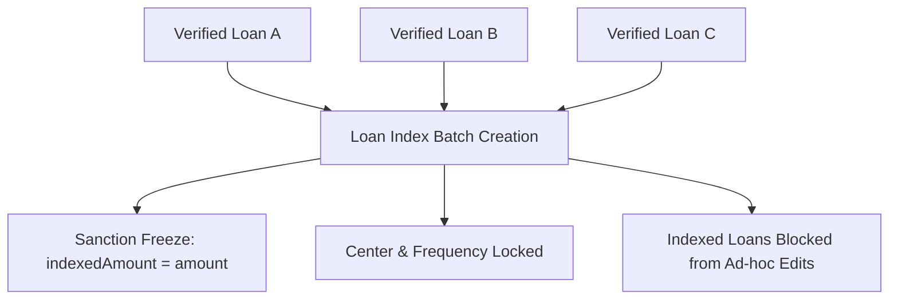

### 13.2 Indexing Rules & Invariants
1. **Homogeneous Grouping:** All loans within an index must belong to the **same Center** and share the **same Repayment Frequency**.
2. **Sanction Ceiling Freeze (`indexedAmount`):** Upon index creation, the system copies `Loan.amount` into `Loan.indexedAmount`. This freezes the sanctioned principal, preventing any subsequent modification of loan amounts during approval workflows.
3. **Duplicate Prevention:** A loan attached to an active, unrejected `LoanIndex` cannot be attached to any other index.

---

## 14. Disbursement Approval Workflow

Disbursement follows a strict multi-level authorization pipeline:

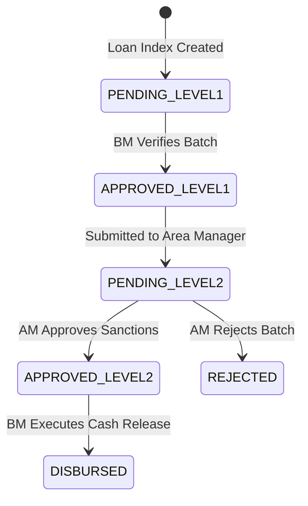

### 14.1 Level 1 — Branch Manager Review
- **Actor:** Branch Manager.
- **Scope:** Verifies center member attendance, application completeness, and initial documentation.
- **Status Change:** Transitions `DisbursementStatus` from `PENDING_LEVEL1` to `APPROVED_LEVEL1` / `PENDING_LEVEL2`.

### 14.2 Level 2 — Area Manager Sanction
- **Actor:** Area Manager (or Super Admin).
- **Scope:** Cluster-level risk assessment. Evaluates center delinquency, branch liquidity, and client creditworthiness.
- **Maker-Checker Constraint:** Area Managers cannot approve batches if they originated the underlying loans.
- **Status Change:** Transitions `DisbursementStatus` to `APPROVED_LEVEL2`.

---

## 15. Branch Manager Final Disbursement

### 15.1 Cash Release Execution
Final disbursement (`/disbursements/bm-disburse`) is executed by the Branch Manager on the scheduled center meeting date.

### 15.2 Mandatory Execution Pre-Checks
The disbursement engine (`app/api/disbursements/bm-disburse/route.ts`) evaluates four mandatory gates before committing funds:
1. **Level 2 Sanction Gate:** `disbursementStatus` must be strictly `APPROVED_LEVEL2`.
2. **MI & GRT Clearance:** `findIncompleteMemberIndividualLoanIds` confirms no loans are missing field verification records.
3. **Gold Collateral Gate:** For gold-backed products, `findGoldLoansMissingPhoto` confirms that physical ornament pledge photographs are uploaded.
4. **Working Date Synchronization:** Transaction timestamps are mapped to `BranchWorkingDate.workingDate`.

### 15.3 System Mutations on Disbursement
Upon execution, the database atomically performs:
- Updates `DisbursementStatus` to `DISBURSED`.
- Updates `Loan.status` to `DISBURSED` (or `ACTIVE`) and stamps `disbursedAt`.
- Auto-generates the complete repayment schedule (`LoanSchedule` records).
- Generates automated double-entry GL accounting transactions tagged with idempotency markers.
- Deducts upfront fees (insurance, documentation charges) from cash disbursed or logs fee collection receipts.

---

## 16. Repayment Schedule Generation

### 16.1 Installment Compilation Engine
The schedule generation service compiles installment records based on the immutable loan product terms:
- **Principal Component:** Total principal divided across dues (or amortized via reducing balance formula).
- **Interest Component:** Calculated per due according to Flat or Reducing formulas.
- **Savings Component:** Mandatory recurring savings contribution added to installment demand.

### 16.2 Calendar Day & Non-Working-Day Rules
- **Weekly / Fortnightly Alignments:** Due dates align with the Center's scheduled meeting day (e.g., Every Tuesday).
- **Sunday & Holiday Rollover:** The schedule generator checks against configured branch non-working days. Due dates falling on a Sunday or official branch holiday automatically roll forward to the next authorized operational working day.

---

## 17. Repayment & Collection

The application provides five distinct collection workflows catering to field and branch realities:

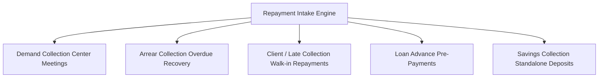

### 17.1 Collection Workflows
1. **Demand Collection (`/collections/demand`):** Bulk collection entered during weekly center meetings based on auto-compiled Demand Sheets.
2. **Arrear Collection (`/collections/arrear`):** Specific collection targeted at delinquent installments past their working due dates.
3. **Client / Late Collection (`/collections/single`):** Ad-hoc repayments made by individual borrowers at the branch counter outside standard center meeting schedules.
4. **Loan Advance:** Advance installment payments deposited ahead of schedule, tracked in dedicated advance balances.
5. **Savings Collection:** Independent recurring thrift deposits credited to the client's internal savings ledger.

### 17.2 Collection Intake Fields
- `workingDate`: Anchored to the branch's active working date.
- `paymentMode`: Cash, UPI, or Bank Transfer.
- `cashDenominations`: Denomination count breakdown (2000, 500, 200, 100, 50, 20, 10) required for physical cash tally verification.
- `meetingPhotoUrl`: Meeting photo evidence uploaded during mobile/field center collections.

---

## 18. Repayment Waterfall & Schedule Allocation

### 18.1 Mathematical Priority Waterfall
When collections are allocated against loan schedules during EOD processing, funds are applied strictly according to the verified repayment priority waterfall:

$$\text{Allocation Priority: } \mathbf{Penalty} \longrightarrow \mathbf{Fees} \longrightarrow \mathbf{Overdue Interest} \longrightarrow \mathbf{Overdue Principal} \longrightarrow \mathbf{Current Interest} \longrightarrow \mathbf{Current Principal}$$

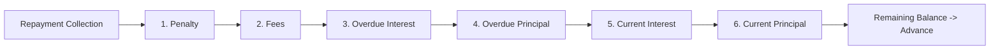

### 18.2 Schedule Ordering & Partial Allocation
1. **Chronological Due Ordering:** Allocations evaluate schedules ordered strictly by `installmentNumber ASC` and `dueDate ASC`. Overdue installments must be satisfied completely before funds apply to current dues.
2. **Partial Settlements:** If the collected sum is insufficient to cover a full installment, it satisfies interest components first before extinguishing principal.
3. **Savings Separation Invariant:** Savings collections are credited directly to the client's separate savings ledger account and are **never** commingled or diverted into the loan principal/interest repayment waterfall.

---

## 19. Outstanding, Arrear, Current Due & Advance

The platform maintains distinct mathematical definitions for loan portfolio risk metrics:

| Financial Metric | Mathematical Implementation Formula | Authoritative Data Source | Description |
| :--- | :--- | :--- | :--- |
| **Principal Outstanding (OS)** | $\sum \text{Schedule.principal} - \sum \text{Schedule.principalPaid}$ | `LoanSchedule` | Actual unpaid principal balance remaining across all future and current installments. |
| **Interest Outstanding (OS)** | $\sum \text{Schedule.interest} - \sum \text{Schedule.interestPaid}$ | `LoanSchedule` | Total unpaid scheduled interest across the loan tenure. |
| **Arrear / Overdue** | $\sum (\text{principalDue} + \text{interestDue})$ for all dues where $\text{dueDate} < \text{BranchWorkingDate}$ | `LoanSchedule` compared against `BranchWorkingDate` | Installment sums that have passed their scheduled due date without complete collection. |
| **Current Due** | Dues where $\text{dueDate} = \text{BranchWorkingDate}$ | `LoanSchedule` | Installment amounts demanding collection on the branch's active working date. |
| **Advance Balance** | Lump-sum repayments held in `Loan.advanceBalance` | `LoanTransaction` | Surplus funds deposited ahead of schedule, automatically drawn down as future dues mature. |

---

## 20. Foreclosure, Preclosure & Closure

### 20.1 Normal Loan Maturity Closure
When regular installment repayments completely satisfy all principal, interest, and fee schedules ($\text{Principal OS} = 0$), the repayment engine automatically updates `Loan.status` to `CLOSED` and stamps `closedAt`.

### 20.2 Unified Preclosure Architecture (`ForeclosureRequest`)
Borrowers wishing to extinguish their liability ahead of maturity follow the unified `ForeclosureRequest` workflow (`/loans/foreclosure`):
1. **Settlement Quotation:** System calculates exact Principal Outstanding plus accrued interest up to the active working date.
2. **Unearned Future Interest Waiver:** Future scheduled interest is automatically waived, creating offsetting credit adjustments.
3. **Maker-Checker Control:** The Branch Manager initiates the request; approval requires an Area Manager or Admin sign-off. The initiating manager is strictly prevented from self-approving.
4. **Schedule Liquidation:** Upon settlement approval, all remaining open `LoanSchedule` rows are updated to status `CLOSED` (or `WAIVED`), and the loan is marked `CLOSED`.

### 20.3 Write-Off & Death Settlement Workflows
- **Write-Off:** Severely delinquent loans categorized as unrecoverable can be written off under Head Office authorization, transferring outstanding principal to bad-debt expense ledgers while updating status to `WRITTEN_OFF`.
- **Death Settlement:** Where client death protection policies apply, insurance claims liquidate outstanding principal balances, closing the facility upon claim verification.

---

## 21. Gold Loan Lifecycle & Physical Collateral

The Gold Loan module manages loans secured by gold ornaments and jewellery, implementing physical collateral custody controls.

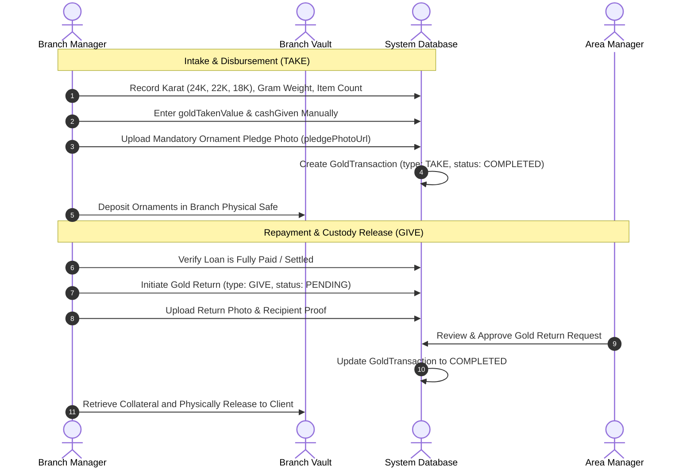

### 21.1 Gold Valuation & The `GoldPrice` Reality
- **Gold Price Catalog:** The platform maintains a branch-level gold rate master (`GoldPrice` via `/masters/gold-price`) tracking market rates per gram across karats (24K, 22K, 20K, 18K, 16K).
- **Current Operational Valuation Reality:** The audited disbursement flow (`app/api/disbursements/bm-disburse/route.ts`) **does not use `GoldPrice` to automatically calculate loan sanctions**. The Branch Manager manually evaluates collateral purity and manually enters `goldTakenValue` and `cashGiven`.

### 21.2 Custody Events: TAKE vs. GIVE
1. **Gold TAKE (Disbursement):** Executed during loan release. Captures gross weight, net weight, karat purity, and requires a mandatory ornament pledge photograph (`pledgePhotoUrl`).
2. **Gold GIVE (Release):** Initiated upon complete loan closure. Captures return photographs (`returnPhotoUrl`), verified recipient identity, and requires mandatory Area Manager approval before physical ornaments can be released from the branch safe.

---

## 22. Center Management, FDO Assignment & Transfer History

### 22.1 Center Administration
Centers are created under `/masters/centers`, defining the center name, meeting day (Monday through Saturday), meeting frequency, location coordinates, and assigned collection FDO.

### 22.2 Center Transfer History vs. Center Assign History
The system tracks organizational and officer movements through two distinct report architectures:

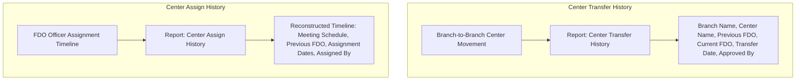

1. **Center Transfer History:** A transfer-event report documenting the formal transfer of a Center from one Branch to another. Captures Branch Name, Center Name, Previous FDO, Current FDO, Transfer Date, and Approving Supervisor.
2. **Center Assign History:** An operational timeline reconstructing the chronological history of frontline officers (FDOs) assigned to manage a specific center. Captures Meeting Day, Meeting Schedule, Previous FDO, Previous Assignment Range (From / Till), Current FDO, Assigned Date, and Assigning Manager.

---

## 23. Funder Management

### 23.1 External Capital Funding
Microfinance operations often utilize debt capital provided by external financial institutions or institutional funders. Funders are configured in the Funder Master (`/masters/funders`).

### 23.2 Funder Portfolio Tagging
- **Disbursement Allocation:** During Loan Indexing or BM Disburse, loans can be tagged to a specific Funder ID.
- **Relational Integrity:** Each loan maintains a single active Funder association, linking portfolio risk and receivables to the external capital source.

### 23.3 Accounting & Funder OS Tracking
- **Automated Segregation:** Financial postings distinguish loan assets funded by internal capital from those funded via external funder credit lines.
- **Funder OS Reporting:** Dedicated portfolio reporting (`/reports/funder-os-report`) tracks principal collections, interest margins, and remaining portfolio balances categorized by funder.

---

## 24. Financial Accounting & Automated GL Posting

### 24.1 Chart of Accounts Structure
The general ledger is organized across a multi-tier hierarchy:
- **Account Groups:** Top-level classifications (Assets, Liabilities, Income, Expenses, Equity).
- **Account Ledgers:** Specific operational and control accounts (e.g., Cash in Hand, HDFC Bank, Loan Portfolio Principal, Interest Income, Processing Fee Income, Insurance Payable).
- **Self Accounts:** Internal settlement and clearing accounts mapped per branch.

### 24.2 Operational Automated Posting vs. Manual Vouchers

```mermaid
graph TD
    subgraph Automated Operational Posting
        OpEvent[Disbursement / Collection Allocation / Foreclosure] --> Marker[Generate postingMarker Key]
        Marker --> AutoFT[FinancialTransaction Status: APPROVED]
        AutoFT --> Lines[FinancialTransactionLine Dr/Cr Entries]
    end

    subgraph Manual Voucher Workflow Maker-Checker
        BMEntry[BM Creates Cash / Bank / Journal Voucher] --> P1[Status: PENDING_AM_APPROVAL]
        P1 --> AMAppr[AM Review & Approval]
        AMAppr --> P2[Status: PENDING_ADMIN_APPROVAL]
        P2 --> AdminAppr[Admin Final Approval]
        AdminAppr --> PostFT[FinancialTransaction Status: APPROVED]
    end
```

1. **Automated Operational Posting:** System operations (Disbursements, EOD Collection Allocations, Foreclosure settlements) **bypass manual voucher approval queues**. They post directly to `FinancialTransaction` in status `APPROVED`, tagged with unique idempotency keys (`postingMarker`, such as `[POSTING:INDEX:${indexId}:DISBURSEMENT]`). This ensures that retries or re-allocations never post duplicate ledger entries.
2. **Manual Vouchers:** Ad-hoc expenses, branch cash transfers, and manual journal adjustments follow strict Maker-Checker queues:
   - BM creates voucher (`PENDING_AM_APPROVAL`).
   - AM reviews and approves (`PENDING_ADMIN_APPROVAL`).
   - Head Office Admin grants final approval (`APPROVED`), committing lines to the General Ledger.

---

## 25. End-of-Day Processing & Working-Date Advancement

### 25.1 Working Date Authority
Operations in Sarvam Microfinance do not anchor to server calendar clocks. Every branch maintains an independent, authoritative operational date stored in `BranchWorkingDate.workingDate`. All collections, schedule movements, and ledger vouchers anchor strictly to this date.

### 25.2 Operational Window Enforcement Reality
- **Historical Policy:** Version 1.0 described an automated lockout preventing branch operations outside 09:00–18:00 IST.
- **Current Software Reality:** In `app/lib/branch-lock.ts`, the validation function `assertBranchNotLocked` is **stubbed to return `null`**. Automated time-based write lockouts are **not currently enforced**, permitting operational data entry 24/7 while maintaining working-date integrity.

### 25.3 EOD Prerequisites & Verification Gates
The End-of-Day routine (`/eod/process`) executes the formal closure of the branch working day. The service enforces strict prerequisite checks before allowing closure:
1. **Attendance Reconciliation Gate:** Meeting attendance must be recorded for all scheduled center meetings, and branch employee attendance must be logged.
2. **Denomination Reconciliation Gate:** Physical cash counts entered via Denomination Entry must perfectly match the net total of approved cash collections and payments.
3. **Collection Allocation Completion Gate:** All submitted collections must be approved by the BM and allocated via EOD Allocation (`eodAllocatedAt` stamped).
4. **Working-Date Advancement:** Upon passing all gates, the system stamps `isClosed = true` on the daily log and advances `BranchWorkingDate.workingDate` to the next operational business day (automatically skipping Sundays and configured holidays).

---

## 26. Reversal Architecture

Rollback operations are structured across a strict **reversal dependency hierarchy**, preventing data corruption, accounting mismatches, and orphan ledger lines.

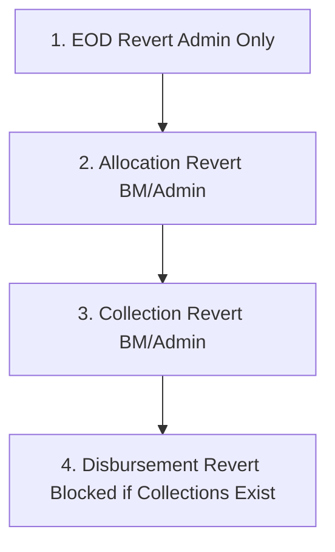

### 26.1 The Reversal Dependency Hierarchy
1. **EOD Revert (`/revert/eod`):**
   - **Precondition:** Requires Head Office Admin authority. Can only revert the most recently closed working date.
   - **Operational Effect:** Re-opens the closed working date by decrementing `BranchWorkingDate.workingDate`.
   - **Crucial Distinction:** **EOD Revert is NOT an accounting rollback.** It does not alter financial ledger entries or unallocate repayments; it solely re-opens the operational day for transaction adjustments.
2. **Allocation Revert (`/revert/allocation`):**
   - **Precondition:** Working day must be open.
   - **Operational Effect:** Unstamps `eodAllocatedAt` from collections, cancels automated GL vouchers, and unwinds schedule allocations, returning collections to an unallocated state.
3. **Collection Revert (`/revert/collection`):**
   - **Precondition:** Collections must not be allocated (or must have undergone Allocation Revert first).
   - **Operational Effect:** Reverts collection status from `APPROVED` back to `PENDING` or `REJECTED`, allowing frontline corrections.
4. **Disbursement Revert (`/revert/disbursement`):**
   - **Strict Downstream Dependency:** Disbursement Revert is **strictly blocked** if any repayment, savings deposit, or fee collection has been recorded against any loan in the index. All subsequent collections must be fully reversed before a disbursement can be rolled back.

---

## 27. Employee, Attendance & Payroll

### 27.1 Human Resource Roster
Branch staff (BM, FDOs, administrative staff) are managed under `/employees`. The system maintains employment profiles, designation tiers, assigned home branches, and identity records.

### 27.2 Attendance Tracking & Verification
- **Daily Attendance Marking:** Staff log daily check-ins via web or mobile portals.
- **Biometric & Facial Verification:** Mobile attendance capture incorporates facial recognition matching against stored employee profile images.
- **EOD Gate Binding:** EOD processing verifies that branch staff attendance is fully reconciled before permitting daily closure.

### 27.3 Salary Components & Monthly Payroll
- **Salary Components:** Defined under `/payroll/components` (Basic Pay, House Rent Allowance, Travel Allowance, Special Allowances, and Statutory Deductions).
- **Payroll Execution:** Monthly salary generation compiles `SalaryPayRecord` entries based on reconciled working days, leave records, and approved pay structures.

---

## 28. Reports Engine & Report Generation

### 28.1 Dual Report Generation Architecture

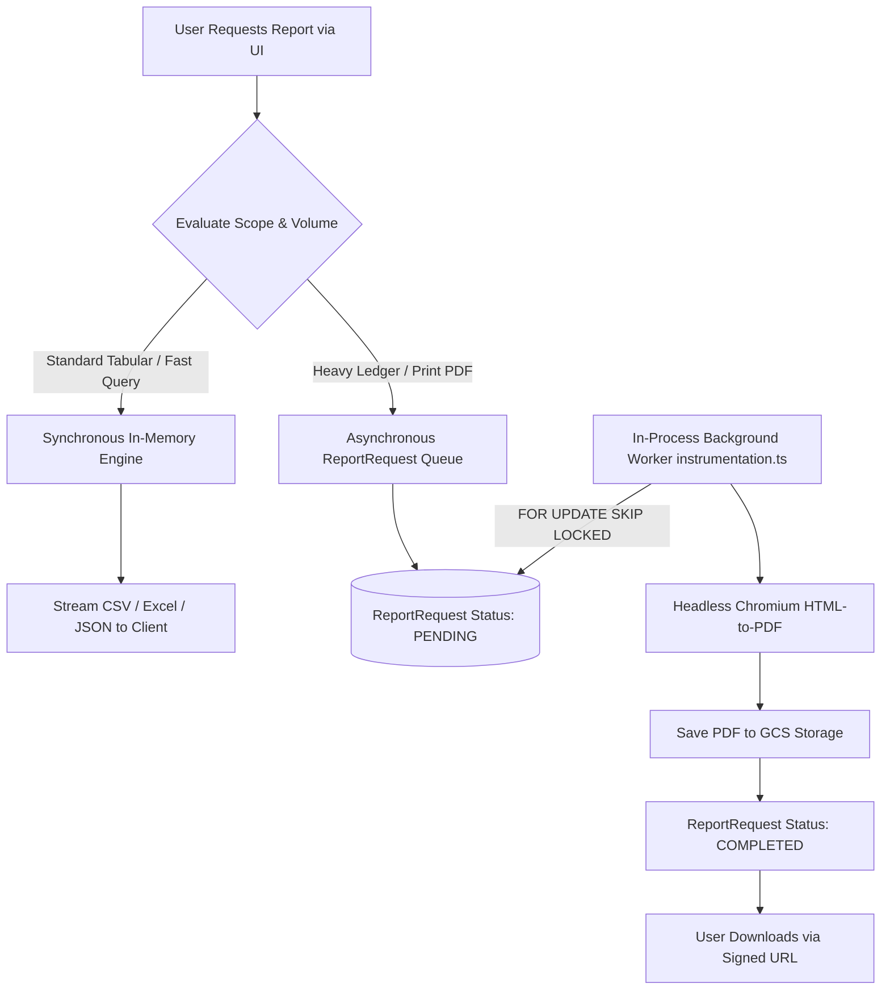

1. **Synchronous In-Memory Engine:** Handles fast tabular queries, CSV exports, and interactive UI grids (e.g., Demand Sheets, Daily Collection Summaries).
2. **Asynchronous Worker Queue (`ReportRequest`):** Large, computationally intensive reports (General Ledgers, Funder OS, DCB, Audit Compilations) enqueue a `ReportRequest` row. The background worker polls the queue using `FOR UPDATE SKIP LOCKED`, spins up headless Puppeteer Chromium instances, compiles pixel-perfect PDF/Excel artifacts, persists them to private GCS storage, and issues signed download URLs.

### 28.2 Comprehensive Report Registry Inventory

The system registers over 60 active operational report slugs in `app/lib/reports/report-registry.ts`:

| Category | Representative Report Slugs | Primary Functional Focus |
| :--- | :--- | :--- |
| **Demand & Collection** | `demand-sheet`, `future-demand`, `collection-receipts`, `officer-wise-receipts`, `zero-collection`, `advance-collection` | Daily meeting dues, officer collection productivity, and collection shortfall tracking. |
| **Portfolio & Risk** | `individual-ledger`, `loan-disbursement-report`, `par-report`, `preclosure-report`, `center-master` | Outstanding loan balances, Portfolio At Risk (PAR) aging buckets, and foreclosure histories. |
| **Management MIS** | `company-profile`, `age-wise-arrear`, `branch-demand`, `loan-os-details`, `all-dcb`, `client-wise-dcb` | High-level executive portfolios, Demand-Collection-Balance (DCB) aggregations, and arrears. |
| **Accounting & Financial** | `daybook`, `gl-report-single`, `gl-report-all`, `trial-balance`, `receipts-payments`, `ledger-report` | Double-entry financial statement compilation, voucher audits, and cash/bank reconciliation. |
| **Funder Reports** | `funder-report`, `funder-interest`, `funder-os-report` | External institutional capital utilization, receivables, and funder-level risk tracking. |
| **Operational & History** | `center-transfer-history`, `center-assign-history`, `attendance-detailed`, `denomination-collection` | Center geographic shifts, historical FDO assignment timelines, and cash denominations. |

---

## 29. MIS & Portfolio Reporting

### 29.1 Demand, Collection, Balance (DCB) Compilation
The core metric of portfolio health is compiled through the DCB aggregation service (`app/lib/reports/dcb-aggregation.ts`):
- **Opening Demand / Balance:** Prior period outstanding arrears and balances carried forward.
- **Current Demand:** All principal, interest, and fee installments maturing within the filter date range.
- **Collection:** Actual realized repayments allocated during the period.
- **Closing Balance:** Remaining outstanding principal plus delinquent overdue balances.

### 29.2 Portfolio At Risk (PAR) Aging Buckets
Portfolio risk is categorized into delinquency buckets based on days past due relative to the active branch working date:
- **PAR 1–30:** Early-stage overdue delinquency (1 to 30 days past due).
- **PAR 31–60:** Mid-stage delinquency requiring supervisory intervention.
- **PAR 61–90:** High-risk portfolio default warning.
- **PAR 90+ / NPA:** Non-Performing Assets eligible for provisioning or write-off review.

---

## 30. Export & Formatting Standards

To ensure institutional presentation consistency across all external artifacts, the system enforces uniform rendering rules:

### 30.1 Typography Standards
- **Font Family:** Strictly **Times New Roman** applied across all PDF documents, Word documents, and formatted Excel sheets.
- **CSV Exception:** Plain CSV exports carry raw tabular text without embedded font formatting.
- **Base Font Sizing:** 11pt baseline font size applied across table cells, body summaries, and financial ledgers.

### 30.2 Monetary Presentation Truncation Rule
- **Export Display Truncation (`Math.trunc`):** Tabular report displays, PDF vouchers, and spreadsheet exports format monetary values by **truncating decimal fractions towards zero** (`Math.trunc(amount)`).
- **Precision Invariant:** Truncation applies **exclusively to visual presentation and document export rendering**. Underlying database columns (`Decimal(12,2)` / floating-point calculations), schedule allocation engines, and accounting journal balances maintain full mathematical precision without decimal loss.

---

## 31. Technical Architecture, Security & Storage

### 31.1 Application Architecture
- **Stateless Next.js Server:** App Router API endpoints operate statelessly, resolving user context from verified JWTs and active branch headers.
- **Database Connection Pooling:** PostgreSQL connectivity via Prisma is bounded to a pool size of 20 connections, preventing connection thrashing during intensive EOD or report generation tasks.

### 31.2 Document Storage Security
- **Private GCS Architecture:** KYC documents (Aadhaar cards, Voter IDs), client portraits, meeting photographs, and gold pledge evidence are stored in a private Google Cloud Storage bucket with public access blocked.
- **Signed URL Access:** Media delivery is mediated strictly via short-lived, cryptographically signed URLs (15-minute validity window) generated dynamically by the application server.

### 31.3 Security & Session Protections
- **Transport Encryption:** Enforces TLS communication.
- **Password Security:** Salted bcrypt password hashing.
- **SQL Injection & XSS Mitigations:** Parameterized database queries mediated via Prisma ORM; input sanitization via Zod schema validation.

---

## 32. Complete Menu Path Reference

The application navigation is organized across functional workspaces reflecting verified application routes:

| Workspace / Module | Menu Item Display | Exact Application Route | Authorized Roles |
| :--- | :--- | :--- | :--- |
| **Dashboard** | Executive Dashboard | `/dashboard` | All authenticated users (scoped by role) |
| **Hub / Branch** | Branch Working Date | `/admin/branch-working-date` | Admin, Area Manager, Branch Manager |
| **Client Operations** | Client Enrollment | `/clients/enroll` | FDO, BM, Admin |
| **Client Operations** | Client Approval Workbench | `/approval/clients` | BM, AM, Admin |
| **Client Operations** | Client Directory / Search | `/clients` | All Roles (Branch scoped) |
| **Center Operations** | Center Management | `/masters/centers` | Admin, AM, BM |
| **Center Operations** | Group Management | `/masters/groups` | BM, FDO |
| **Loan Operations** | Create Loan Application | `/loans/applications/create` | FDO, BM, Admin |
| **Loan Operations** | Loan Verification (MI/GRT) | `/loans/verification` | FDO, BM |
| **Loan Operations** | Create Loan Index | `/loans/indexes/create` | Branch Manager, Admin |
| **Disbursement** | Level 2 Index Approval | `/approval/disbursements` | Area Manager, Admin |
| **Disbursement** | BM Final Cash Disburse | `/disbursements/bm-disburse` | Branch Manager, Admin |
| **Collections** | Demand Collection | `/collections/demand` | FDO, BM |
| **Collections** | Arrear Collection | `/collections/arrear` | FDO, BM |
| **Collections** | Client / Late Collection | `/collections/single` | BM, Cashier, Admin |
| **Collections** | Collection Batch Approval | `/approval/collections` | Branch Manager, Admin |
| **Gold Operations** | Gold Loan Initiation | `/gold/loans/create` | FDO, BM |
| **Gold Operations** | Gold Transactions (GIVE/TAKE)| `/gold/transactions` | BM, AM, Admin |
| **Gold Operations** | Gold Price Master | `/masters/gold-price` | Admin, Area Manager |
| **Accounting** | Financial Transactions | `/financial-transactions` | BM, AM, Admin |
| **Accounting** | Chart of Accounts | `/accounting/chart-of-accounts`| Admin |
| **EOD Operations** | End-of-Day Execution | `/eod/process` | Branch Manager, Admin |
| **Reversals** | Reversal Workbench | `/revert` | Admin, Branch Manager (scoped) |
| **HRMS & Payroll** | Employee Management | `/employees` | Admin, AM, BM |
| **HRMS & Payroll** | Attendance Workbench | `/attendance` | All Staff, BM, Admin |
| **HRMS & Payroll** | Monthly Payroll Run | `/payroll/run` | Admin, BM |
| **Reports** | Reports Central Hub | `/reports` | All Roles (Scoped permissions) |
| **MIS** | Executive MIS Analytics | `/mis` | Admin, Area Manager |

---

## 33. Entity Status Dictionary

To eliminate historical confusion, entity statuses are documented across their specific database enum dimensions:

### 33.1 Client Approval Status (`Client.status`)
- `DRAFT`: Client profile under compilation by FDO; not submitted.
- `SUBMITTED`: Form finalized and queued for initial branch review.
- `PENDING_BM_REVIEW`: Awaiting Branch Manager scrutiny.
- `BM_RETAKE_REQUIRED`: Returned by BM to FDO for document correction.
- `PENDING_AM_REVIEW`: Passed by BM; awaiting Area Manager scrutiny.
- `AM_RETAKE_REQUIRED`: Returned by AM to FDO for correction.
- `PENDING_FINAL_REVIEW`: Passed by AM; queued for Head Office final approval.
- `FINAL_RETAKE_REQUIRED`: Returned by Head Office reviewer for correction.
- `APPROVED`: Fully verified and active; eligible for loan issuance.
- `REJECTED`: Disqualified and permanently archived.

### 33.2 Loan Application Status (`LoanApplication.status`)
- `DRAFT`: Loan application initiated; details incomplete.
- `SUBMITTED`: Submitted by FDO for field verification.
- `UNDER_REVIEW`: Under scrutiny by verification team.
- `VERIFIED`: MI and GRT checks completed successfully; eligible for indexing.
- `APPROVED`: Formally sanctioned.
- `REJECTED`: Loan request denied.

### 33.3 Disbursement Status (`Loan.disbursementStatus`)
- `PENDING_LEVEL1`: Loan indexed; awaiting BM Level 1 verification.
- `APPROVED_LEVEL1`: Verified by BM; queued for Area Manager sanction.
- `PENDING_LEVEL2`: Awaiting Level 2 approval by Area Manager.
- `APPROVED_LEVEL2`: Sanctioned by Area Manager; ready for cash release.
- `DISBURSED`: Final cash disburse executed by BM; schedule active.
- `REJECTED`: Disbursement batch rejected during approval review.

### 33.4 Operational Loan Status (`Loan.status`)
- `PENDING`: Provisioned loan record awaiting index sanction and disbursement.
- `APPROVED`: Sanction approved; awaiting cash disburse.
- `DISBURSED`: Funds released to borrower; initial state before repayments.
- `ACTIVE`: Active repayment lifecycle underway.
- `CLOSED`: Fully liquidated via normal repayments or approved settlement.
- `WRITTEN_OFF`: Declared non-performing loss; balances written off.

### 33.5 Financial Transaction Status (`FinancialTransaction.status`)
- `DRAFT`: Manual voucher draft.
- `PENDING_AM_APPROVAL`: Manual voucher awaiting Area Manager approval.
- `PENDING_ADMIN_APPROVAL`: Manual voucher awaiting Admin approval.
- `APPROVED`: Formally committed to General Ledger (includes automated operational postings).
- `REJECTED`: Voucher rejected during review.
- `CANCELLED`: Voided voucher.

### 33.6 Foreclosure Request Status (`ForeclosureRequest.status`)
- `PENDING`: Preclosure initiated; quotation generated; awaiting AM approval.
- `APPROVED`: Preclosure authorized by Area Manager; awaiting cash settlement.
- `SETTLED`: Full settlement funds collected; loan closed.
- `REJECTED`: Preclosure request denied by supervisor.
- `CANCELLED`: Request withdrawn by branch.

---

## 34. Cross-System Business Rules, Limitations & Glossary

### 34.1 Consolidated Business Rules Matrix

| Rule Domain | Specific Rule Description | Enforcement Mechanism |
| :--- | :--- | :--- |
| **Client Eligibility** | Loans can only be provisioned for clients in `APPROVED` status. | Enforced in loan creation API and `createFirstLoanIfEligible`. |
| **Group Capacity** | Peer lending groups cannot exceed a maximum of 5 members. | Validated in `GroupAssignmentConfig` during client enrollment. |
| **Sanction Ceiling Freeze**| Sanctioned principal is frozen upon indexing (`indexedAmount = amount`). | Index creation logic in `app/api/loan-indexes/route.ts`. |
| **Field Verification Gate** | Disbursement blocked if MI or GRT records are missing. | Pre-check `findIncompleteMemberIndividualLoanIds` in BM Disburse. |
| **Gold Collateral Gate** | Gold disbursement blocked if ornament pledge photos are missing. | Pre-check `findGoldLoansMissingPhoto` in BM Disburse. |
| **Waterfall Allocation** | Repayment funds prioritize Penalty → Fees → Overdue Int/Prin → Current Int/Prin. | Mathematical allocation loop in schedule repayment engine. |
| **Savings Isolation** | Savings collections cannot be applied to satisfy loan principal or interest. | Maintained in separate savings transaction ledgers. |
| **Maker-Checker Integrity**| Managers cannot approve foreclosure requests or vouchers they initiated. | User ID comparison check in approval controllers. |
| **Reversal Ordering** | Reversals follow strict hierarchy: EOD Revert → Allocation Revert → Collection Revert. | Dependency check in reversal controllers. |
| **Disbursement Revert Block**| Disbursement Revert strictly blocked if any subsequent repayment exists. | Transaction existence query in disbursement revert service. |
| **Working Date Dominance** | All operational and accounting dates derive from `BranchWorkingDate.workingDate`. | Transaction creation handlers across all modules. |

### 34.2 Current System Limitations & Non-Implemented Features
1. **No Objection Certificate (NOC) Module:**
   - *Limitation:* **NOC certificate issuance is not currently implemented as a software workflow.** The platform does not contain an NOC generation engine, approval workflow, or printable NOC certificate. "NOC" in the current codebase refers strictly to image upload fields (`noc_image_1` through `noc_image_4`) utilized to capture local clearance documents during initial client enrollment.
2. **Gold Price Auto-Valuation:**
   - *Limitation:* The `GoldPrice` catalog operates as an unlinked rate master. Market prices do not automatically calculate collateral valuation or cash disburse ceilings during Gold Loan creation; the Branch Manager evaluates ornaments and enters figures manually.
3. **Automated Operating Window Lock:**
   - *Limitation:* The historic 09:00–18:00 IST branch lock is currently inactive (`assertBranchNotLocked` returns `null`), allowing continuous operational data entry.

### 34.3 Comprehensive System Glossary
- **ABAC:** Attribute-Based Access Control; contextual runtime permission constraints.
- **Center:** Field operational unit grouping multiple peer borrowing groups meeting on fixed schedules.
- **DCB:** Demand, Collection, Balance; the core portfolio accounting metric tracking microfinance health.
- **EOD:** End-of-Day; the formal branch accounting reconciliation process advancing the operational working date.
- **FDO:** Field Development Officer; frontline staff conducting center meetings and onboarding borrowers.
- **GL:** General Ledger; the financial double-entry bookkeeping ledger of all debit and credit accounts.
- **GRT:** Group Recognition Test; oral and procedural examination verifying peer-group joint liability understanding.
- **JLG:** Joint Liability Group; mutual accountability borrowing model where 5 members peer-guarantee loans.
- **Loan Index:** A batch container grouping verified loans for a single center to undergo simultaneous sanction and disbursement.
- **MI:** Member Individual; physical dwelling and household verification conducted prior to loan indexing.
- **PAR:** Portfolio At Risk; the proportion of outstanding portfolio balances displaying overdue delinquency.
- **Posting Marker:** Unique cryptographic or structured string (`[POSTING:INDEX:...]`) ensuring idempotent GL posting.
- **RBAC:** Role-Based Access Control; system granting capabilities via database-persisted roles and permission slugs.
- **Working Date:** The active accounting date of a branch (`BranchWorkingDate`), advanced solely via successful EOD execution.
